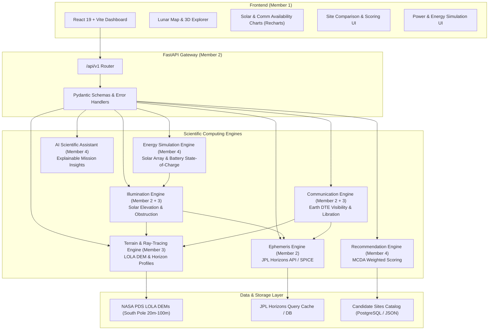

# LUNA NAVIGATOR — System Architecture Specification

## 1. Executive Summary

**LUNA NAVIGATOR** is an AI-powered scientific decision-support system designed for mission planners to evaluate, rank, and simulate lunar south-pole landing sites for robotic and crewed exploration missions.

The platform combines validated orbital mechanics (NASA JPL Horizons / SPICE ephemerides), high-resolution topographic models (NASA LOLA / LROC DEMs), line-of-sight ray tracing, mission energy simulations, and multi-criteria decision analysis (MCDA) recommendations.

---

## 2. Team Member Ownership & Boundary Matrix

| Member | Domain | Key Responsibilities | Assigned Path(s) |
| :--- | :--- | :--- | :--- |
| **Member 1** | Frontend Development | React dashboard, lunar visualization, solar/comm charts, site comparison, UI responsiveness | `frontend/` |
| **Member 2** | Backend & Ephemeris | FastAPI REST framework, NASA JPL Horizons client, ephemeris engine, solar/Earth coordinates | `backend/app/api/`, `backend/app/services/`, `backend/app/engines/ephemeris/` |
| **Member 3** | GIS & Scientific Computing | LOLA DEM ingestion, elevation profiles, terrain horizon generation, ray tracing, obstruction analysis | `backend/app/engines/terrain/`, `backend/app/services/geospatial/`, `datasets/` |
| **Member 4** | AI/ML & System Integration | Multi-factor site scoring engine, mission energy simulation, AI assistant, validation & docs | `backend/app/engines/recommendation/`, `backend/app/engines/simulation/`, `backend/app/services/ai/`, `docs/` |

---

## 3. High-Level Architecture Diagram



---

## 4. Lunar Coordinate & Reference Systems

All calculations and data models must adhere to established International Astronomical Union (IAU) lunar working group conventions:

1. **Lunar Mean Earth / Polar Axis (ME) Frame**:
   - The primary selenographic body-fixed frame used for NASA LOLA and LROC data products.
   - Origin: Center of mass of the Moon.
   - Z-axis: Lunar mean rotation axis (pointing to Lunar North).
   - X-axis: Direction of Lunar Mean Earth direction at zero longitude and zero latitude.
   - Y-axis: Completes the right-handed Cartesian coordinate system ($Y = Z \times X$).

2. **Selenographic Polar Coordinates**:
   - **Latitude ($\phi$)**: Degrees North (positive) or South (negative), $[-90^\circ, +90^\circ]$. The Lunar South Pole is $-90^\circ$.
   - **Longitude ($\lambda$)**: East-positive convention, $[0^\circ, 360^\circ)$ or $[-180^\circ, +180^\circ]$.
   - **Elevation ($h$)**: Topographic height relative to the standard lunar reference sphere of radius $R_{moon} = 1737.4\text{ km}$ ($1,737,400\text{ meters}$).

3. **Local Topocentric Horizon System (Observer Frame)**:
   - For an observer at $(\phi, \lambda, h)$, the local horizontal coordinate system is defined by:
     - **Up (Zenith $\hat{u}$)**: Normal to the lunar reference ellipsoid / local tangent plane.
     - **North ($\hat{n}$)**: Tangent pointing toward the lunar North Pole.
     - **East ($\hat{e}$)**: Tangent pointing toward East ($\hat{e} = \hat{n} \times \hat{u}$).
   - **Azimuth ($Az$)**: Angle measured clockwise from North ($0^\circ = \text{North}, 90^\circ = \text{East}, 180^\circ = \text{South}, 270^\circ = \text{West}$).
   - **Elevation / Altitude ($El$)**: Angle above the local horizon plane, $[-90^\circ, +90^\circ]$.

---

## 5. Directory Layout & Standards

```
luna-navigator/
├── frontend/                 # Member 1
│   ├── public/
│   ├── src/
│   │   ├── components/       # Reusable UI widgets (cards, meters, selectors)
│   │   ├── pages/            # Core views (Dashboard, Explorer, Compare, Simulation)
│   │   ├── hooks/            # Custom React hooks (useEphemeris, useSiteData)
│   │   ├── services/         # Axios API clients
│   │   ├── utils/            # Coordinate conversions, date formatters
│   │   └── App.jsx
│   ├── package.json
│   └── vite.config.js
│
├── backend/                  # Members 2, 3, 4
│   ├── app/
│   │   ├── main.py           # FastAPI entrypoint and middleware
│   │   ├── api/v1/           # API version 1 route definitions
│   │   ├── core/             # Configuration, coordinate math, constants
│   │   ├── schemas/          # Pydantic request and response contracts
│   │   ├── models/           # SQLAlchemy ORM models (optional DB persistence)
│   │   ├── services/         # Orchestration & data caching services
│   │   └── engines/          # Scientific compute modules
│   │       ├── ephemeris/    # Member 2: JPL Horizons client & celestial vectors
│   │       ├── terrain/      # Member 3: LOLA DEM raster processing & ray tracing
│   │       ├── illumination/ # Member 2+3: Solar altitude & shadow determination
│   │       ├── communication/# Member 2+3: Earth line-of-sight & libration tracking
│   │       ├── recommendation/# Member 4: Multi-attribute scoring & ranking
│   │       └── simulation/   # Member 4: Power profile, battery SoC, thermal load
│   ├── tests/                # Automated pytest suite
│   └── requirements.txt
│
├── datasets/                 # Member 3 & shared datasets
│   ├── dem/                  # GeoTIFF / NetCDF elevation rasters (LOLA)
│   ├── imagery/              # WAC/NAC base orthomosaics
│   ├── processed/            # Cached horizon masks & pre-computed ray caches
│   └── sample/               # Ground-truth candidate sites & benchmark records
│
├── docs/                     # Architecture, API contracts, mathematical docs
├── .gitignore
├── README.md
└── docker-compose.yml
```

---

## 6. Scientific Calculation Pipeline

```
Mission Configuration (Site coordinates, Start Time UTC, Duration, Step Size)
                     │
                     ▼
  [1. Ephemeris Engine] ───> Obtains Moon-to-Sun & Moon-to-Earth vectors from JPL Horizons
                     │
                     ▼
  [2. Local Topocentric Transform] ───> Computes geometric Solar Az/El & Earth Az/El over time
                     │
                     ▼
  [3. Terrain Horizon Engine] ───> Generates $360^\circ$ terrain obstruction mask from LOLA DEM
                     │
                     ▼
  [4. Visibility & Line-of-Sight Determination]
       ├── Solar Illumination: $El_{sun}(t) > HorizonObstruction(Az_{sun}(t))$
       └── Earth Visibility:   $El_{earth}(t) > HorizonObstruction(Az_{earth}(t))$
                     │
                     ▼
  [5. Simulation & Scoring Pipeline]
       ├── Energy Simulation: Solar array irradiance $\times$ incidence angle - Rover hotel load $\to$ Battery SoC
       └── Site Scoring: $Score = \sum w_i \times Metric_i$ (Illumination %, Max Shadow Hrs, Comm %, Slope)
```
